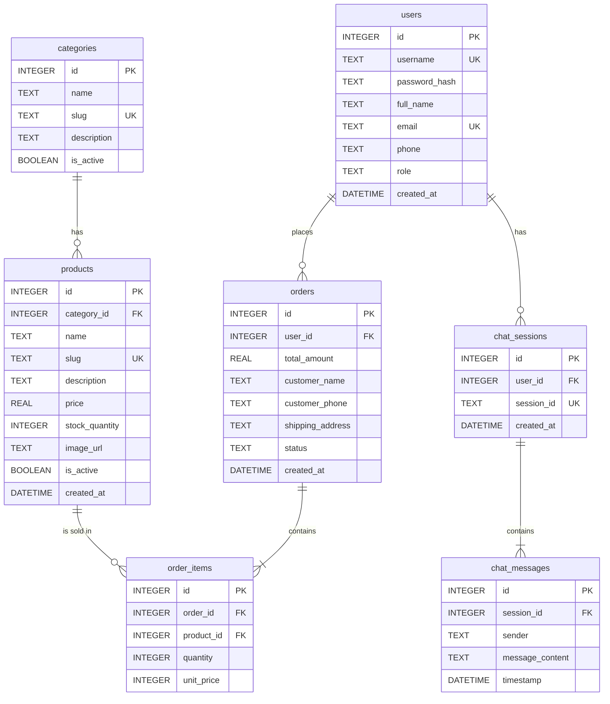

# Thiết kế Cơ sở dữ liệu (Database Design)

Tài liệu này trình bày chi tiết về thiết kế cơ sở dữ liệu quan hệ cho Hệ thống Quản lý Bán hàng Tích hợp AI. Cơ sở dữ liệu được thiết kế tương thích với chuẩn **SQLite** (và có thể dễ dàng migrate sang PostgreSQL).

---

## 1. Sơ đồ Quan hệ Thực thể (ERD)

Sơ đồ ERD thể hiện mối quan hệ giữa các thực thể chính trong hệ thống.



---

## 2. Từ điển Dữ liệu Chi tiết (Data Dictionary)

Dưới đây là đặc tả chi tiết của từng bảng dữ liệu, ánh xạ đến các Class Model trong tài liệu thiết kế.

### 2.1. Bảng `users` (DB-TAB-001 | CLS-001)

*Quản lý thông tin tài khoản người dùng.*

| STT | Tên trường     | Kiểu dữ liệu | Ràng buộc               | Mô tả ý nghĩa             |
| --- | ----------------- | --------------- | ------------------------- | ----------------------------- |
| 1   | `id`            | INTEGER         | PK, AUTOINCREMENT         | Khóa chính                  |
| 2   | `username`      | TEXT            | NOT NULL, UNIQUE          | Tên đăng nhập             |
| 3   | `password_hash` | TEXT            | NOT NULL                  | Mật khẩu đã băm          |
| 4   | `full_name`     | TEXT            |                           | Họ và tên                  |
| 5   | `email`         | TEXT            | UNIQUE                    | Địa chỉ email              |
| 6   | `phone`         | TEXT            |                           | Số điện thoại             |
| 7   | `role`          | TEXT            | DEFAULT 'customer', CHECK | Vai trò (admin/customer)     |
| 8   | `created_at`    | DATETIME        | DEFAULT CURRENT_TIMESTAMP | Thời điểm tạo tài khoản |

### 2.2. Bảng `categories` (DB-TAB-002 | CLS-002)

*Quản lý danh mục sản phẩm.*

| STT | Tên trường   | Kiểu dữ liệu | Ràng buộc       | Mô tả ý nghĩa         |
| --- | --------------- | --------------- | ----------------- | ------------------------- |
| 1   | `id`          | INTEGER         | PK, AUTOINCREMENT | Khóa chính              |
| 2   | `name`        | TEXT            | NOT NULL          | Tên danh mục            |
| 3   | `slug`        | TEXT            | NOT NULL, UNIQUE  | Đường dẫn tĩnh URL   |
| 4   | `description` | TEXT            |                   | Mô tả danh mục         |
| 5   | `is_active`   | BOOLEAN         | DEFAULT 1         | Trạng thái hoạt động |

### 2.3. Bảng `products` (DB-TAB-003 | CLS-003)

*Quản lý danh sách sản phẩm (Dùng nạp Context cho AI).*

| STT | Tên trường      | Kiểu dữ liệu | Ràng buộc               | Mô tả ý nghĩa              |
| --- | ------------------ | --------------- | ------------------------- | ------------------------------ |
| 1   | `id`             | INTEGER         | PK, AUTOINCREMENT         | Khóa chính                   |
| 2   | `category_id`    | INTEGER         | FK (categories.id)        | Khóa ngoại danh mục         |
| 3   | `name`           | TEXT            | NOT NULL                  | Tên sản phẩm                |
| 4   | `slug`           | TEXT            | NOT NULL, UNIQUE          | Đường dẫn tĩnh URL        |
| 5   | `description`    | TEXT            |                           | Mô tả chi tiết cho AI đọc |
| 6   | `price`          | INTEGER         | NOT NULL                  | Giá bán                      |
| 7   | `stock_quantity` | INTEGER         | NOT NULL, DEFAULT 0       | Số lượng tồn kho           |
| 8   | `image_url`      | TEXT            |                           | Link ảnh sản phẩm           |
| 9   | `is_active`      | BOOLEAN         | DEFAULT 1                 | Trạng thái kinh doanh        |
| 10  | `created_at`     | DATETIME        | DEFAULT CURRENT_TIMESTAMP | Ngày thêm sản phẩm         |

### 2.4. Bảng `orders` (DB-TAB-004 | CLS-004)

*Quản lý hóa đơn / Đơn hàng.*

| STT | Tên trường        | Kiểu dữ liệu | Ràng buộc               | Mô tả ý nghĩa               |
| --- | -------------------- | --------------- | ------------------------- | ------------------------------- |
| 1   | `id`               | INTEGER         | PK, AUTOINCREMENT         | Khóa chính                    |
| 2   | `user_id`          | INTEGER         | FK (users.id)             | Người mua (nếu đăng nhập) |
| 3   | `total_amount`     | INTEGER         | NOT NULL                  | Tổng tiền thanh toán         |
| 4   | `customer_name`    | TEXT            |                           | Tên người nhận              |
| 5   | `customer_phone`   | TEXT            |                           | Số điện thoại nhận hàng   |
| 6   | `shipping_address` | TEXT            |                           | Địa chỉ giao hàng           |
| 7   | `status`           | TEXT            | DEFAULT 'pending', CHECK  | Trạng thái đơn              |
| 8   | `created_at`       | DATETIME        | DEFAULT CURRENT_TIMESTAMP | Thời gian tạo đơn           |

### 2.5. Bảng `order_items` (DB-TAB-005 | CLS-005)

*Chi tiết các mặt hàng trong đơn hàng.*

| STT | Tên trường  | Kiểu dữ liệu | Ràng buộc                | Mô tả ý nghĩa          |
| --- | -------------- | --------------- | -------------------------- | -------------------------- |
| 1   | `id`         | INTEGER         | PK, AUTOINCREMENT          | Khóa chính               |
| 2   | `order_id`   | INTEGER         | NOT NULL, FK (orders.id)   | Khóa ngoại đơn hàng   |
| 3   | `product_id` | INTEGER         | NOT NULL, FK (products.id) | Khóa ngoại sản phẩm    |
| 4   | `quantity`   | INTEGER         | NOT NULL                   | Số lượng mua            |
| 5   | `unit_price` | INTEGER         | NOT NULL                   | Đơn giá lúc mua        |

### 2.6. Bảng `chat_sessions` (DB-TAB-006 | CLS-006)

*Quản lý các phiên hội thoại với AI.*

| STT | Tên trường  | Kiểu dữ liệu | Ràng buộc               | Mô tả ý nghĩa             |
| --- | -------------- | --------------- | ------------------------- | ----------------------------- |
| 1   | `id`         | INTEGER         | PK, AUTOINCREMENT         | Khóa chính                  |
| 2   | `user_id`    | INTEGER         | FK (users.id)             | Người dùng chat (nếu có) |
| 3   | `session_id` | TEXT            | NOT NULL, UNIQUE          | Mã định danh UUID phiên   |
| 4   | `created_at` | DATETIME        | DEFAULT CURRENT_TIMESTAMP | Thời gian tạo phiên        |

### 2.7. Bảng `chat_messages` (DB-TAB-007 | CLS-007)

*Lưu trữ tin nhắn lịch sử phục vụ AI memory.*

| STT | Tên trường       | Kiểu dữ liệu | Ràng buộc                     | Mô tả ý nghĩa        |
| --- | ------------------- | --------------- | ------------------------------- | ------------------------ |
| 1   | `id`              | INTEGER         | PK, AUTOINCREMENT               | Khóa chính             |
| 2   | `session_id`      | INTEGER         | NOT NULL, FK (chat_sessions.id) | Thuộc phiên chat nào  |
| 3   | `sender`          | TEXT            | NOT NULL, CHECK                 | 'user' hoặc 'assistant' |
| 4   | `message_content` | TEXT            | NOT NULL                        | Nội dung tin nhắn      |
| 5   | `timestamp`       | DATETIME        | DEFAULT CURRENT_TIMESTAMP       | Thời gian gửi          |

---

## 3. Chiến lược Đánh chỉ mục & Tối ưu hóa (Indexes)

- `DB-IDX-001`: `idx_products_category` (Tối ưu truy vấn sản phẩm theo nhóm hàng).
- `DB-IDX-002`: `idx_products_slug` (Tối ưu tra cứu chi tiết sản phẩm trên giao diện).
- `DB-IDX-003`: `idx_orders_user` (Tối ưu tìm lịch sử mua hàng của User).
- `DB-IDX-004`: `idx_chat_messages_session` (Tối ưu tải lịch sử chat cho LLM).
- `DB-IDX-005`: `idx_chat_sessions_user` (Tìm danh sách phiên chat của 1 User).
- `DB-IDX-006`: `idx_order_items_order` (Tối ưu truy vấn chi tiết đơn hàng).
- `DB-IDX-007`: `idx_order_items_product` (Tối ưu khóa ngoại sản phẩm).

---

## 4. Script DDL Khởi tạo CSDL (SQLite)

```sql
-- DDL for SQLite

-- 1. Tables Creation
CREATE TABLE users (
    id INTEGER PRIMARY KEY AUTOINCREMENT,
    username TEXT NOT NULL UNIQUE,
    password_hash TEXT NOT NULL,
    full_name TEXT,
    email TEXT UNIQUE,
    phone TEXT,
    role TEXT DEFAULT 'customer' CHECK(role IN ('admin', 'customer')),
    created_at DATETIME DEFAULT CURRENT_TIMESTAMP
);

CREATE TABLE categories (
    id INTEGER PRIMARY KEY AUTOINCREMENT,
    name TEXT NOT NULL,
    slug TEXT NOT NULL UNIQUE,
    description TEXT,
    is_active BOOLEAN DEFAULT 1
);

CREATE TABLE products (
    id INTEGER PRIMARY KEY AUTOINCREMENT,
    category_id INTEGER,
    name TEXT NOT NULL,
    slug TEXT NOT NULL UNIQUE,
    description TEXT,
    price INTEGER NOT NULL,
    stock_quantity INTEGER NOT NULL DEFAULT 0,
    image_url TEXT,
    is_active BOOLEAN DEFAULT 1,
    created_at DATETIME DEFAULT CURRENT_TIMESTAMP,
    FOREIGN KEY(category_id) REFERENCES categories(id) ON DELETE SET NULL
);

CREATE TABLE orders (
    id INTEGER PRIMARY KEY AUTOINCREMENT,
    user_id INTEGER,
    total_amount INTEGER NOT NULL,
    customer_name TEXT,
    customer_phone TEXT,
    shipping_address TEXT,
    status TEXT DEFAULT 'pending' CHECK(status IN ('pending', 'processing', 'shipped', 'delivered', 'cancelled')),
    created_at DATETIME DEFAULT CURRENT_TIMESTAMP,
    FOREIGN KEY(user_id) REFERENCES users(id) ON DELETE SET NULL
);

CREATE TABLE order_items (
    id INTEGER PRIMARY KEY AUTOINCREMENT,
    order_id INTEGER NOT NULL,
    product_id INTEGER NOT NULL,
    quantity INTEGER NOT NULL,
    unit_price INTEGER NOT NULL,
    FOREIGN KEY(order_id) REFERENCES orders(id) ON DELETE CASCADE,
    FOREIGN KEY(product_id) REFERENCES products(id) ON DELETE CASCADE
);

CREATE TABLE chat_sessions (
    id INTEGER PRIMARY KEY AUTOINCREMENT,
    user_id INTEGER,
    session_id TEXT NOT NULL UNIQUE,
    created_at DATETIME DEFAULT CURRENT_TIMESTAMP,
    FOREIGN KEY(user_id) REFERENCES users(id) ON DELETE CASCADE
);

CREATE TABLE chat_messages (
    id INTEGER PRIMARY KEY AUTOINCREMENT,
    session_id INTEGER NOT NULL,
    sender TEXT NOT NULL CHECK(sender IN ('user', 'assistant')),
    message_content TEXT NOT NULL,
    timestamp DATETIME DEFAULT CURRENT_TIMESTAMP,
    FOREIGN KEY(session_id) REFERENCES chat_sessions(id) ON DELETE CASCADE
);

-- 2. Indexes Creation
CREATE INDEX idx_products_category ON products(category_id);
CREATE INDEX idx_products_slug ON products(slug);
CREATE INDEX idx_orders_user ON orders(user_id);
CREATE INDEX idx_chat_messages_session ON chat_messages(session_id);
CREATE INDEX idx_chat_sessions_user ON chat_sessions(user_id);
CREATE INDEX idx_order_items_order ON order_items(order_id);
CREATE INDEX idx_order_items_product ON order_items(product_id);

-- 3. Seed Data
-- Users
INSERT INTO users (username, password_hash, full_name, email, phone, role) VALUES 
('admin', '$2b$12$e/K9...hashed', 'Quản trị viên', 'admin@store.com', '0123456789', 'admin'),
('customer1', '$2b$12$e/K9...hashed', 'Khách hàng 1', 'cust1@gmail.com', '0987654321', 'customer');

-- Categories
INSERT INTO categories (name, slug, description, is_active) VALUES 
('Tai nghe', 'tai-nghe', 'Tai nghe nhạc chất lượng cao', 1),
('Điện thoại', 'dien-thoai', 'Điện thoại thông minh', 1),
('Phụ kiện', 'phu-kien', 'Sạc, cáp, ốp lưng', 1),
('Đồng hồ thông minh', 'dong-ho', 'Smartwatch đo sức khỏe', 1);

-- Products (15 sample items)
INSERT INTO products (category_id, name, slug, description, price, stock_quantity, is_active) VALUES 
(1, 'Tai nghe Sony WH-1000XM4', 'tai-nghe-sony-xm4', 'Tai nghe chống ồn đỉnh cao, pin 30h.', 6500000, 10, 1),
(1, 'Apple AirPods Pro 2', 'airpods-pro-2', 'Chống ồn chủ động xuất sắc, pin cải thiện.', 5500000, 20, 1),
(1, 'Tai nghe JBL T110', 'jbl-t110', 'Tai nghe in-ear giá rẻ, âm bass mạnh.', 250000, 50, 1),
(1, 'Tai nghe Marshall Major IV', 'marshall-major-4', 'Tai nghe on-ear, pin 80h.', 3500000, 15, 1),
(2, 'iPhone 15 Pro Max', 'iphone-15-pro-max', 'Chip A17 Pro, khung viền titan.', 30000000, 15, 1),
(2, 'Samsung Galaxy S24 Ultra', 'galaxy-s24-ultra', 'Màn hình 6.8 inch, AI tích hợp.', 28000000, 12, 1),
(2, 'Xiaomi 14 Pro', 'xiaomi-14-pro', 'Sạc siêu nhanh, camera Leica.', 22000000, 8, 1),
(2, 'Oppo Find X7', 'oppo-find-x7', 'Thiết kế đẹp, camera chuyên nghiệp.', 20000000, 5, 1),
(3, 'Cáp sạc Anker Type-C', 'cap-anker-type-c', 'Bền bỉ, sạc nhanh.', 350000, 100, 1),
(3, 'Sạc dự phòng Xiaomi 10000mAh', 'sac-du-phong-xiaomi-10000', 'Gọn nhẹ, tiện lợi.', 450000, 30, 1),
(3, 'Ốp lưng Spigen iPhone 15', 'op-spigen-ip15', 'Chống sốc tiêu chuẩn quân đội.', 400000, 45, 1),
(3, 'Củ sạc Ugreen 65W GaN', 'cu-sac-ugreen-65w', 'Sạc nhanh đa thiết bị.', 650000, 25, 1),
(4, 'Apple Watch Series 9', 'apple-watch-s9', 'Đo nhịp tim, màn hình sáng.', 9500000, 18, 1),
(4, 'Samsung Galaxy Watch 6', 'galaxy-watch-6', 'Theo dõi giấc ngủ tốt hơn.', 6500000, 14, 1),
(4, 'Garmin Forerunner 265', 'garmin-265', 'Chuyên dụng chạy bộ.', 11000000, 6, 1);
```
