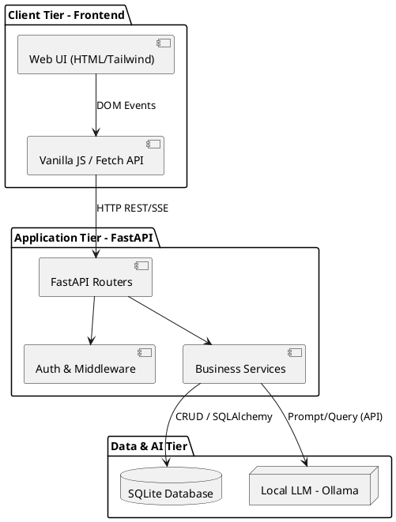
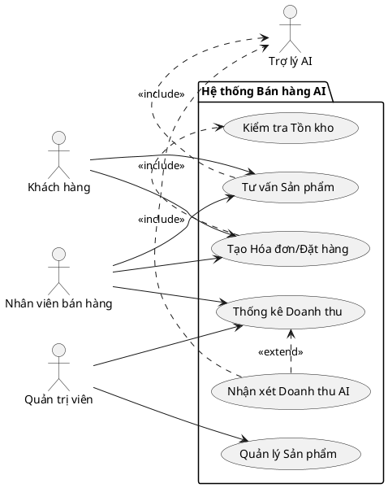
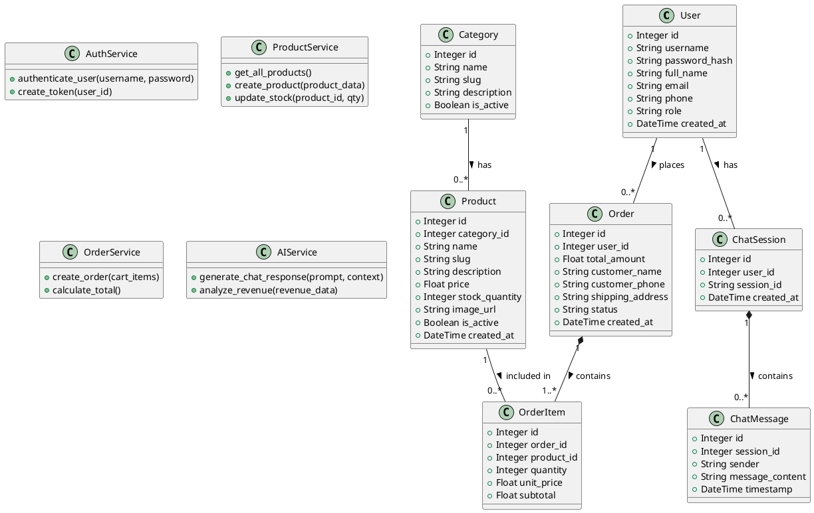
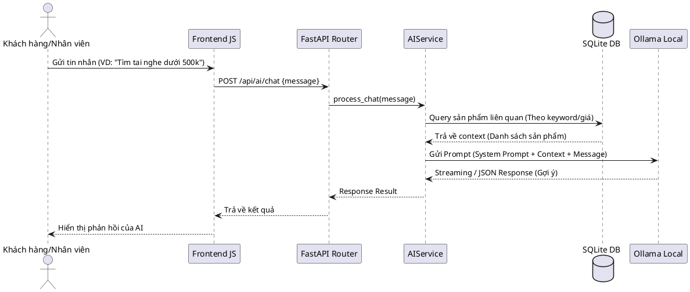
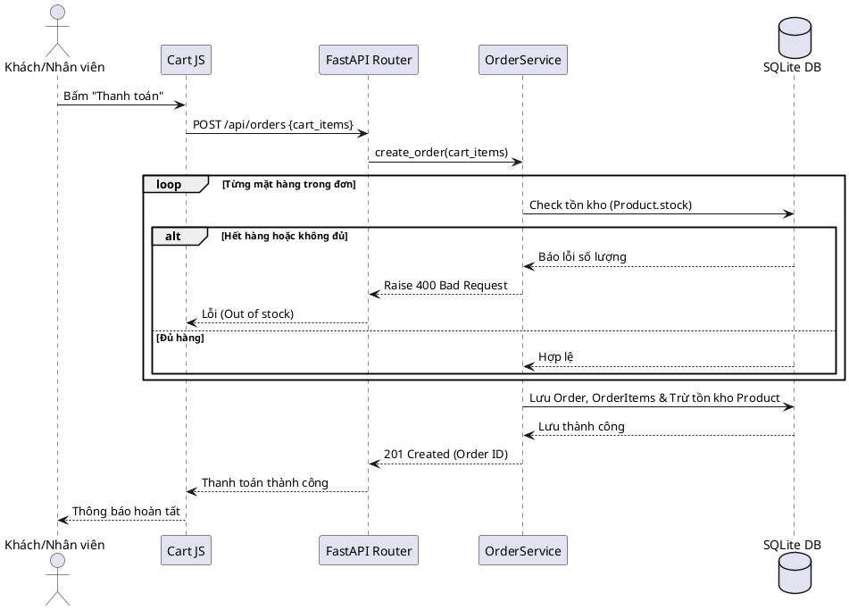
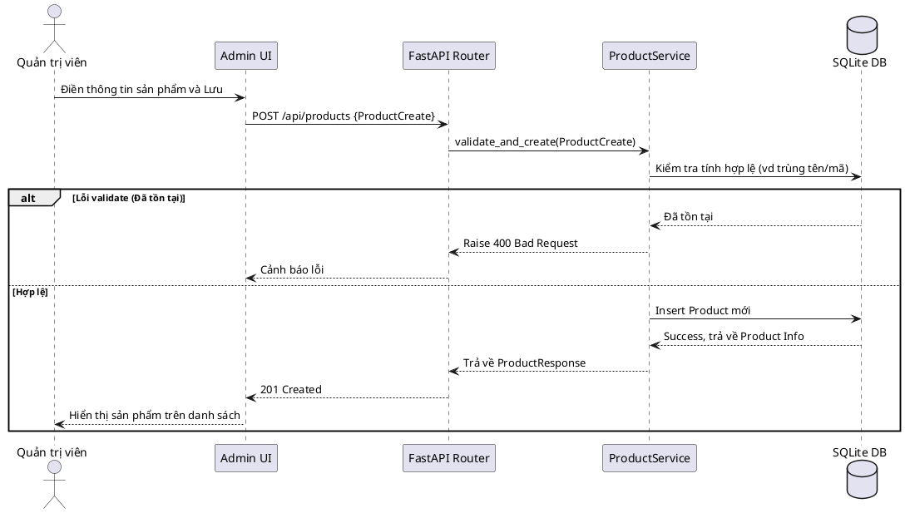
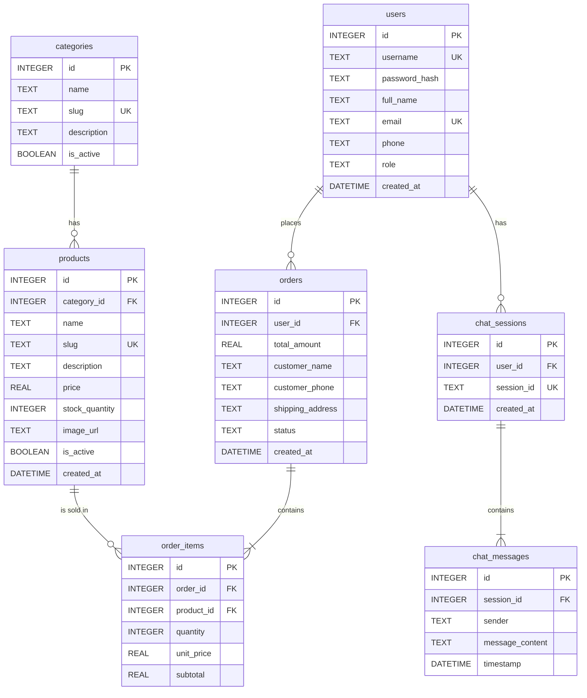

# Báo cáo Phân tích và Thiết kế Hệ thống Quản lý Bán hàng tích hợp AI

---

## CHƯƠNG 1: PHÂN TÍCH YÊU CẦU

### 1.1 Bối cảnh và vấn đề

- **Bối cảnh:** Các cửa hàng bán lẻ cần quản lý hoạt động kinh doanh hằng ngày bao gồm sản phẩm, khách hàng, hóa đơn, doanh thu và tồn kho.
- **Vấn đề:** Việc quản lý thủ công qua sổ sách hoặc bảng tính rời rạc khiến nhân viên dễ nhập sai dữ liệu, khó theo dõi tình trạng tồn kho thực tế và mất nhiều thời gian tổng hợp báo cáo doanh thu.

### 1.2 Mục tiêu hệ thống

- Xây dựng một hệ thống phần mềm quản lý toàn diện (sản phẩm, khách hàng, hóa đơn, nhập xuất tồn, doanh thu) nhằm số hóa quy trình kinh doanh.
- Giúp nhân viên bán hàng thao tác nhanh chóng và chính xác.
- Hỗ trợ chủ cửa hàng theo dõi tình hình kinh doanh theo thời gian thực.
- Tích hợp trí tuệ nhân tạo (AI) để nâng cao trải nghiệm khách hàng và tối ưu hóa quản lý: hỗ trợ tư vấn sản phẩm, sinh nhận xét doanh thu và hỏi đáp dữ liệu bán hàng bằng ngôn ngữ tự nhiên.
- Đóng vai trò là tài liệu phân tích ban đầu cho sinh viên môn Ứng dụng AI.

### 1.3 Actor và nhu cầu

- **Actor: Quản trị viên**
  - **Mục tiêu:** Quản lý toàn bộ hệ thống, cấp quyền người dùng.
  - **Chức năng liên quan:** Đăng nhập/đăng xuất, phân quyền người dùng (chủ cửa hàng, nhân viên bán hàng), thiết lập hệ thống.
- **Actor: Nhân viên bán hàng**
  - **Mục tiêu:** Lập hóa đơn nhanh, tra cứu sản phẩm còn hàng, ghi nhận thanh toán, phục vụ khách hàng.
  - **Chức năng liên quan:** Tìm kiếm sản phẩm, tạo hóa đơn, áp dụng giảm giá, in/xuất hóa đơn, quản lý thông tin khách hàng, tư vấn sản phẩm qua Chatbot AI.
- **Actor: Chủ cửa hàng**
  - **Mục tiêu:** Theo dõi tình hình kinh doanh, quản lý nhập/xuất/tồn kho, đưa ra quyết định nhập hàng.
  - **Chức năng liên quan:** Thống kê doanh thu, xem báo cáo, quản lý nhập hàng, hỏi đáp dữ liệu bán hàng với AI, xem nhận xét doanh thu từ AI.

### 1.4 Yêu cầu chức năng quản lý

- **Quản lý người dùng:** Đăng nhập, đăng xuất, phân quyền quản trị viên, nhân viên bán hàng, chủ cửa hàng.
- **Quản lý sản phẩm:** Thêm, sửa, xóa thông tin sản phẩm (mã, tên, nhóm hàng, giá bán, giá nhập, tồn kho, trạng thái).
- **Quản lý khách hàng:** Lưu trữ thông tin liên hệ, lịch sử mua hàng, phân nhóm khách hàng.
- **Quản lý hóa đơn:** Lập hóa đơn bán hàng, tính tổng tiền, áp dụng giảm giá, ghi nhận phương thức thanh toán.
- **Quản lý kho hàng:** Quản lý nhập hàng và tự động cập nhật số lượng tồn kho.
- **Tìm kiếm và Lọc:** Tra cứu sản phẩm, khách hàng, hóa đơn theo thời gian và trạng thái.
- **Thống kê và Báo cáo:** Thống kê doanh thu theo ngày/tháng, nhóm hàng, sản phẩm bán chạy. Xuất báo cáo ra định dạng PDF/Excel/CSV.

### 1.5 Danh sách chức năng AI

- **Chatbot tư vấn sản phẩm:** Nhận nhu cầu từ khách hàng, tra cứu dữ liệu sản phẩm còn hàng và tự động đưa ra gợi ý sản phẩm phù hợp.
- **AI sinh báo cáo doanh thu:** Phân tích dữ liệu doanh thu, tồn kho, sản phẩm bán chạy để tự động sinh ra các nhận xét ngắn gọn và khuyến nghị nhập/xuất hàng.
- **Hỏi đáp dữ liệu bán hàng:** Cho phép chủ cửa hàng đặt câu hỏi bằng ngôn ngữ tự nhiên (ví dụ: "Tháng này mặt hàng nào bán chậm?") và AI trả lời dựa trên dữ liệu hệ thống hiện tại.

### 1.6 Dữ liệu chính

- **Người dùng/Phân quyền:** Thông tin tài khoản, vai trò (Admin, Nhân viên, Chủ cửa hàng).
- **Sản phẩm:** Mã, tên, danh mục (nhóm hàng), giá bán, giá nhập, tồn kho, trạng thái, mô tả.
- **Khách hàng:** Tên, thông tin liên hệ, lịch sử mua hàng, nhóm khách hàng.
- **Giao dịch (Hóa đơn/Phiếu nhập):** Hóa đơn bán hàng, chi tiết hóa đơn, phiếu nhập hàng, chi tiết phiếu nhập, thông tin thanh toán.

### 1.7 Yêu cầu phi chức năng

- **Bảo mật và Quyền riêng tư:** Không gửi dữ liệu nhạy cảm của khách hàng (như số điện thoại đầy đủ, thông tin thanh toán) sang các API AI nếu không thật sự cần thiết.
- **Hiệu suất:** Tốc độ phản hồi nhanh, đặc biệt là khi tra cứu tồn kho và lập hóa đơn.
- **Tính khả dụng:** Giao diện thân thiện, dễ sử dụng cho nhân viên không chuyên về CNTT.
- **Tính tích hợp:** Cấu hình API key của các dịch vụ AI phải được bảo mật (sử dụng file `.env`).
- **Khả năng triển khai:** Hệ thống có thể demo được trong môi trường local hoặc cloud.

### 1.8 Rủi ro và giả định cần kiểm chứng

- **Rủi ro API AI:** Phụ thuộc vào bên thứ 3 (OpenAI, Gemini, Claude, v.v.), có thể gặp vấn đề về timeout, rate limit hoặc phản hồi sai định dạng (hallucination). Cần cơ chế fallback hoặc kiểm tra kết quả trả về.
- **Rủi ro Dữ liệu:** Chatbot có thể gợi ý sản phẩm đã hết hàng nếu prompt không chặt chẽ hoặc dữ liệu đồng bộ bị chậm. Cần tối ưu và so sánh các phiên bản prompt để giảm thiểu tư vấn sai.
- **Rủi ro Bảo mật:** API key có thể bị lộ nếu đưa vào mã nguồn trực tiếp; rủi ro rò rỉ dữ liệu cá nhân khách hàng khi đưa context vào prompt cho AI.
- **Giả định:** Người dùng có kết nối mạng ổn định để sử dụng các chức năng gọi AI API.

---

## CHƯƠNG 2: THIẾT KẾ HỆ THỐNG

### 2.1 Kiến trúc tổng thể hệ thống (Architecture Overview)

Hệ thống được thiết kế theo mô hình **3 Tầng (3-Tier Architecture)** phân tách rõ ràng trách nhiệm của giao diện, xử lý logic và lưu trữ dữ liệu/mô hình AI:

- **Client Tier (Presentation Layer):** Được xây dựng bằng HTML5, Tailwind CSS và Vanilla JS, đảm nhiệm hiển thị giao diện và tương tác người dùng, gọi API thông qua Fetch/AJAX.
- **Application/API Tier (Business Logic Layer):** Xây dựng trên nền tảng **FastAPI** (Python), cung cấp các API RESTful bất đồng bộ (async). Bao gồm Routers, Middleware (Xác thực, phân quyền) và Business Services.
- **Data & AI Tier:** Sử dụng **SQLite** cho việc lưu trữ dữ liệu quan hệ (Người dùng, Sản phẩm, Hóa đơn). Tích hợp module AI gọi đến local LLM (**Ollama**) xử lý các tác vụ RAG và sinh văn bản tự nhiên.

**Sơ đồ Khối Kiến trúc (COMP-001)**

### 2.2 Mô hình hóa Use Case (Use Case Diagrams)

Phân rã chức năng theo các Actor chính tương tác với hệ thống.

**Chi tiết các Use Case chính:**

1. **UC1 - Tạo Hóa đơn/Đặt hàng:** Khách hàng (hoặc nhân viên bán hàng làm thay khách) thao tác chọn sản phẩm vào giỏ hàng, tính tổng tiền, áp dụng các mã giảm giá và hoàn tất thanh toán. Quá trình này bắt buộc phải gọi hệ thống con để kiểm tra số lượng tồn kho (`<<include>> UC6`).
2. **UC2 - Tư vấn Sản phẩm:** Người dùng (Khách hàng, Nhân viên) sử dụng chatbot để tra cứu thông tin hàng hóa, hỏi đáp cấu hình. Use Case này gọi hệ thống AI (`<<include>> Trợ lý AI`) để tiếp nhận tin nhắn, truy xuất CSDL và sinh ra câu trả lời bằng ngôn ngữ tự nhiên.
3. **UC3 - Quản lý Sản phẩm:** Cho phép Quản trị viên (Admin) thực hiện thao tác CRUD (thêm, sửa, xóa, cập nhật tồn kho, thay đổi trạng thái) đối với danh sách sản phẩm.
4. **UC4 - Thống kê Doanh thu:** Admin hoặc Chủ cửa hàng/Nhân viên (có quyền) xem được báo cáo số liệu, biểu đồ doanh thu theo khoảng thời gian và danh sách các sản phẩm bán chạy nhất.
5. **UC5 - Nhận xét Doanh thu AI:** Là chức năng mở rộng (`<<extend>>`) từ UC4. Khi đang xem báo cáo, người dùng có thể kích hoạt tính năng nhờ AI tóm tắt, phân tích và đưa ra đánh giá, nhận xét tình hình kinh doanh dựa vào số liệu hiện có.
6. **UC6 - Kiểm tra Tồn kho:** Use Case hệ thống, chạy ngầm, đối chiếu số lượng đặt hàng với số lượng thực tế trong CSDL để quyết định cho phép thanh toán hay không.

### 2.3 Thiết kế Sơ đồ Lớp (Class Diagram)

Phản ánh cấu trúc Models (SQLAlchemy entities), Schemas (Pydantic DTOs) và Services xử lý logic.

### 2.4 Thiết kế Sơ đồ Tuần tự (Sequence Diagrams)

**Luồng Tư vấn AI & Gợi ý sản phẩm (SEQ-001)**

**Luồng Thêm vào giỏ hàng & Đặt hàng (SEQ-002)**

**Luồng Quản trị thêm mới sản phẩm (SEQ-003)**

### 2.5 Đặc tả Giao diện API (RESTful API Specifications)

| ID          | Method | Endpoint                    | Mô tả chức năng                                    | Request Body / Params              | Response Code | Yêu cầu (Trace) |
| ----------- | ------ | --------------------------- | ------------------------------------------------------ | ---------------------------------- | ------------- | ----------------- |
| `API-001` | POST   | `/api/auth/login`         | Xác thực đăng nhập, cấp JWT Token                | `{username, password}`           | 200, 401      | REQ-F-004         |
| `API-002` | GET    | `/api/products`           | Lấy danh sách sản phẩm, tồn kho                   | `?category=`, `?search=`       | 200           | REQ-F-001         |
| `API-003` | GET    | `/api/products/{id}`      | Lấy chi tiết thông tin 1 sản phẩm                 | `{id}` (Path)                    | 200, 404      | REQ-F-001         |
| `API-004` | POST   | `/api/products`           | Thêm mới một sản phẩm (Require: Admin Role)       | `{name, price, stock, category}` | 201, 400      | REQ-F-001         |
| `API-005` | PUT    | `/api/products/{id}`      | Cập nhật sản phẩm (Require: Admin Role)            | `{price, stock, status}`         | 200, 404      | REQ-F-001         |
| `API-006` | POST   | `/api/orders`             | Tạo hóa đơn bán hàng (Thanh toán)               | `[{product_id, qty}]`            | 201, 400      | REQ-F-002         |
| `API-007` | GET    | `/api/reports/revenue`    | Thống kê doanh thu, bán chạy                       | `?start_date=`, `?end_date=`   | 200           | REQ-F-003         |
| `API-008` | POST   | `/api/ai/chat`            | Trợ lý Chatbot tư vấn sản phẩm                   | `{message, session_id}`          | 200, 500      | REQ-AI-002        |
| `API-009` | POST   | `/api/ai/analyze-revenue` | AI đọc và nhận xét dữ liệu doanh thu            | `{revenue_data}`                 | 200, 500      | REQ-AI-001        |
| `API-010` | PUT    | `/api/config`             | Cập nhật cấu hình hệ thống (Require: Admin Role) | `{settings}`                     | 200, 403      | REQ-F-006         |

### 2.6 Sơ đồ Quan hệ Thực thể (ERD) và Từ điển Dữ liệu

Sơ đồ ERD thể hiện mối quan hệ giữa các thực thể chính trong hệ thống, tương thích chuẩn SQLite.

**Từ điển Dữ liệu Chi tiết (Data Dictionary):**

1. **`users`**: Quản lý tài khoản (`id`, `username`, `password_hash`, `full_name`, `email`, `phone`, `role`, `created_at`).
2. **`categories`**: Danh mục sản phẩm (`id`, `name`, `slug`, `description`, `is_active`).
3. **`products`**: Sản phẩm dùng nạp Context cho AI (`id`, `category_id`, `name`, `slug`, `description`, `price`, `stock_quantity`, `image_url`, `is_active`, `created_at`).
4. **`orders`**: Quản lý hóa đơn / Đơn hàng (`id`, `user_id`, `total_amount`, `customer_name`, `customer_phone`, `shipping_address`, `status`, `created_at`).
5. **`order_items`**: Chi tiết các mặt hàng trong đơn hàng (`id`, `order_id`, `product_id`, `quantity`, `unit_price`, `subtotal`).
6. **`chat_sessions`**: Quản lý các phiên hội thoại với AI (`id`, `user_id`, `session_id`, `created_at`).
7. **`chat_messages`**: Lưu trữ tin nhắn lịch sử phục vụ AI memory (`id`, `session_id`, `sender`, `message_content`, `timestamp`).

**Chiến lược Đánh chỉ mục & Tối ưu hóa (Indexes):**

- `idx_products_category`: Tối ưu truy vấn sản phẩm theo nhóm hàng.
- `idx_products_slug`: Tối ưu tra cứu chi tiết sản phẩm trên giao diện.
- `idx_orders_user`: Tối ưu tìm lịch sử mua hàng của User.
- `idx_chat_messages_session`: Tối ưu tải lịch sử chat cho LLM.
- `idx_chat_sessions_user`: Tìm danh sách phiên chat của 1 User.
