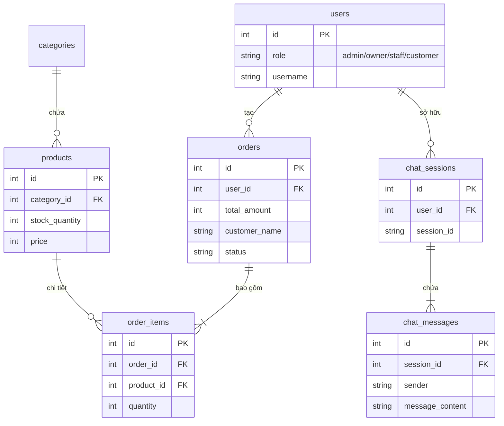

# Thiết kế Sơ đồ Thực thể Liên kết (ERD) - Thực tế Hệ thống

## 1. Danh sách các thực thể và thuộc tính

- **users (Người dùng):** `id`, `username`, `password_hash`, `full_name`, `email`, `phone`, `role` (admin, owner, staff, customer), `is_active`, `created_at`
- **system_configs (Cấu hình hệ thống):** `key`, `value`
- **categories (Danh mục):** `id`, `name`, `slug`, `description`, `is_active`
- **products (Sản phẩm):** `id`, `category_id`, `name`, `slug`, `description`, `price`, `stock_quantity`, `image_url`, `is_active`, `created_at`
- **orders (Đơn hàng):** `id`, `user_id`, `total_amount`, `customer_name`, `customer_phone`, `shipping_address`, `status` (pending, processing, shipped, delivered, cancelled), `created_at`
- **order_items (Chi tiết đơn hàng):** `id`, `order_id`, `product_id`, `quantity`, `unit_price`
- **chat_sessions (Phiên Chat AI):** `id`, `user_id`, `session_id`, `created_at`
- **chat_messages (Tin nhắn Chat AI):** `id`, `session_id`, `sender` (user, assistant), `message_content`, `timestamp`

## 2. Quan hệ giữa các thực thể

- Một **Người dùng** (users) tạo nhiều **Đơn hàng** (orders).
- Một **Danh mục** (categories) có nhiều **Sản phẩm** (products).
- Một **Đơn hàng** (orders) có nhiều **Chi tiết đơn hàng** (order_items).
- Một **Sản phẩm** (products) thuộc nhiều **Chi tiết đơn hàng** (order_items).
- Một **Người dùng** (users) sở hữu nhiều **Phiên chat** (chat_sessions).
- Một **Phiên chat** (chat_sessions) có nhiều **Tin nhắn** (chat_messages).

## 3. Sơ đồ ERD (Mermaid)

