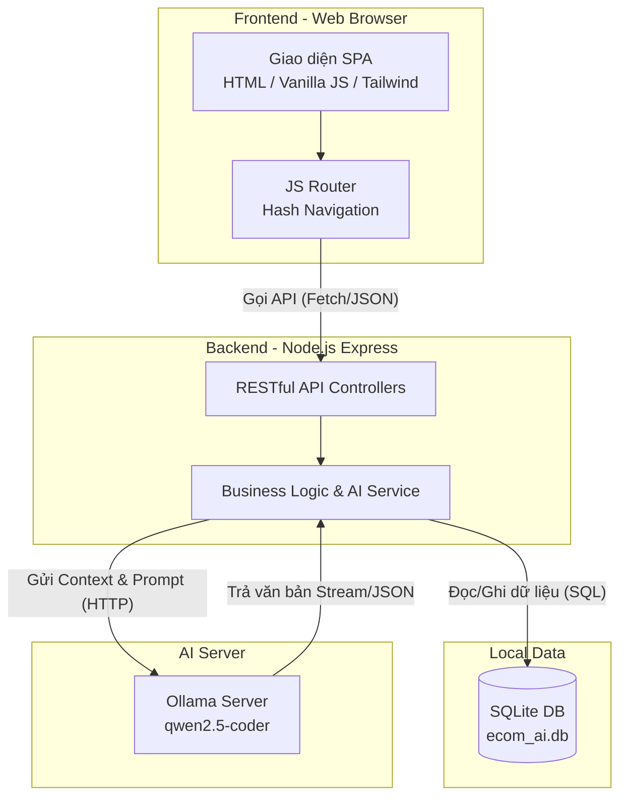

# Kiến trúc Hệ thống (System Architecture)

## 1. Sơ đồ Kiến trúc Tổng thể (C4 Model - Container)

Hệ thống được thiết kế theo mô hình Client-Server, sử dụng ứng dụng web 1 trang (SPA) tương tác với RESTful API, CSDL cục bộ và máy chủ AI nội bộ.



## 2. Thiết kế Cấu trúc Thư mục (Folder Structure)

Cấu trúc dự án áp dụng mô hình phân tách rõ ràng giữa Frontend tĩnh và Backend API.

```text
D:\BanHangAI\
├── frontend/                   # Ứng dụng Single Page Application
│   ├── index.html              # Entry point duy nhất, chứa Layout/Navbar chung
│   └── src/
│       ├── app.js              # Khởi tạo ứng dụng & Core Router lắng nghe Hash (#)
│       ├── views/              # Chứa các Class UI Component
│       │   ├── layouts/        # Layout dùng chung
│       │   ├── pages/          # Các màn hình (StaffPOSView, OwnerDashboardView...)
│       │   └── ChatModule.js   # Khung chat độc lập (Widget)
│       └── assets/             # Hình ảnh, icon, css tùy chỉnh
│
├── backend/                    # Máy chủ API Node.js
│   ├── server.js               # Khởi tạo Express, cấu hình Middleware & Static Files
│   ├── database/
│   │   ├── ecom_ai.db          # File cơ sở dữ liệu SQLite chính
│   │   └── init.sql            # Script khởi tạo cấu trúc bảng (DDL)
│   └── src/
│       ├── routes/             # Định nghĩa API Endpoints (authRoutes, productRoutes...)
│       ├── controllers/        # Xử lý Request/Response HTTP
│       ├── services/           # Logic nghiệp vụ (vd: aiService kết nối Ollama)
│       └── middlewares/        # Xử lý xác thực Token (Auth), bắt lỗi
│
├── specs/                      # Đặc tả yêu cầu và Thiết kế hệ thống
├── prompts/                    # Lưu trữ các prompt giao tiếp với AI (Minh chứng)
└── de_tai_01.md                # Mô tả yêu cầu bài toán gốc
```

## 3. Đặc điểm kỹ thuật
- **Frontend SPA:** Load cực nhanh do không dùng thư viện nặng như React, chỉ thao tác DOM qua chuỗi Template Literal HTML. Mọi chuyển trang được xử lý thông qua `window.location.hash`.
- **Backend Express:** Phục vụ song song 2 chức năng: Chạy API ở `/api/...` và phục vụ Frontend Static file ở các URL còn lại (Catch-all route).
- **Ollama AI:** Tách biệt với Node.js, chạy như một microservice local ở port `11434`, đảm bảo không làm treo server Node.js khi render text nặng.
