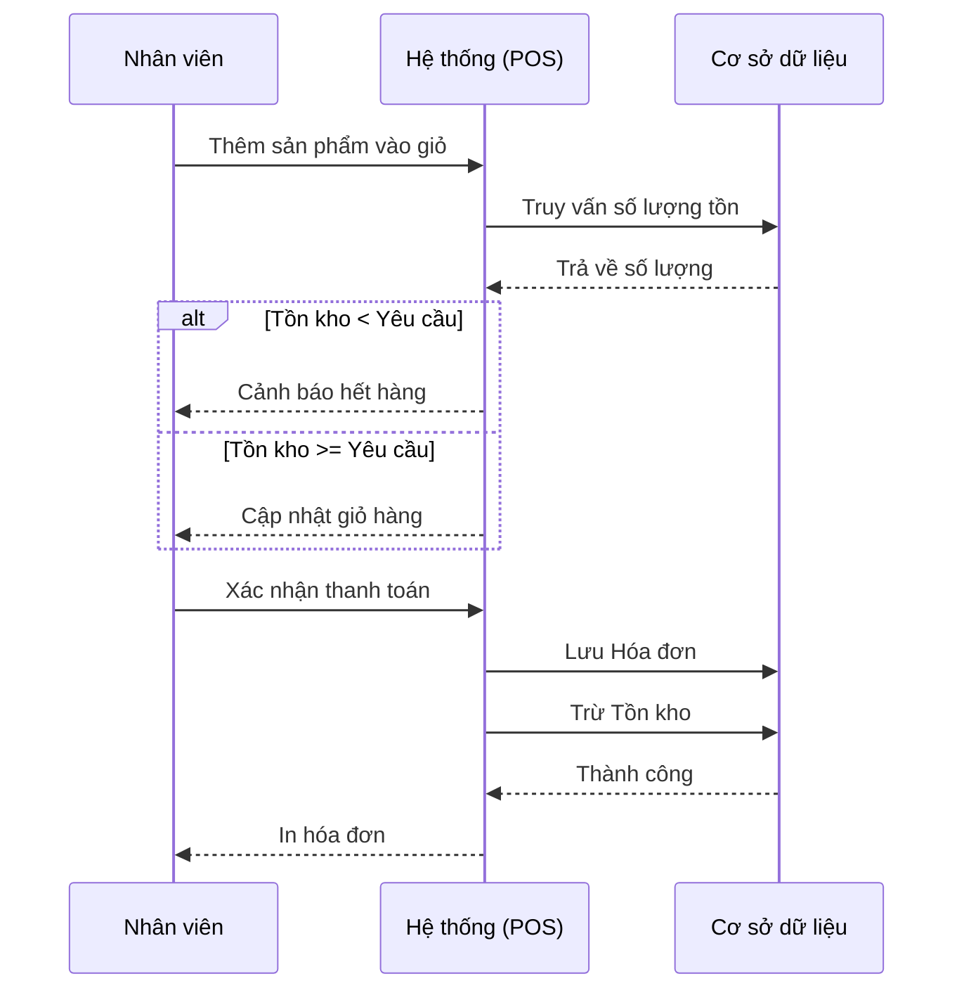

# Phân tích quy trình nghiệp vụ hệ thống quản lý bán hàng

## 1. Quy trình bán hàng và lập hóa đơn
**Actor:** Nhân viên bán hàng, Khách hàng, Hệ thống
**Dữ liệu:** Sản phẩm, Giỏ hàng, Thông tin thanh toán
- **Bước 1:** Nhân viên tìm kiếm/quét mã sản phẩm và thêm vào giỏ hàng.
- **Bước 2:** Hệ thống tự động kiểm tra tồn kho. Nếu không đủ, báo lỗi.
- **Bước 3:** Khách hàng cung cấp thông tin (số điện thoại) để nhân viên liên kết hóa đơn với khách hàng (tùy chọn).
- **Bước 4:** Áp dụng mã giảm giá (nếu có).
- **Bước 5:** Khách hàng thanh toán, nhân viên xác nhận trên hệ thống.
- **Bước 6:** Hệ thống lưu hóa đơn, tự động **trừ** số lượng tồn kho tương ứng.

## 2. Quy trình nhập hàng
**Actor:** Chủ cửa hàng, Hệ thống
**Dữ liệu:** Danh sách sản phẩm nhập, Giá nhập, Số lượng
- **Bước 1:** Chủ cửa hàng tạo Phiếu nhập hàng mới.
- **Bước 2:** Nhập mã sản phẩm, số lượng nhập và giá nhập thực tế.
- **Bước 3:** Xác nhận hoàn tất phiếu nhập.
- **Bước 4:** Hệ thống lưu phiếu nhập và tự động **cộng** số lượng tồn kho.

## 3. Quy trình quản lý tồn kho
**Actor:** Hệ thống (Tự động)
**Dữ liệu:** Số lượng tồn, Hóa đơn (bán/hủy), Phiếu nhập
- **Nhập hàng:** Tồn kho tăng.
- **Bán hàng:** Tồn kho giảm ngay lập tức khi thanh toán thành công.
- **Hủy hóa đơn:** Hệ thống tự động hoàn trả số lượng lại vào tồn kho.
- **Cảnh báo:** Nếu tồn kho dưới mức quy định, đánh dấu đỏ trên giao diện.

## 4. Sơ đồ luồng (Mermaid) - Quy trình bán hàng

