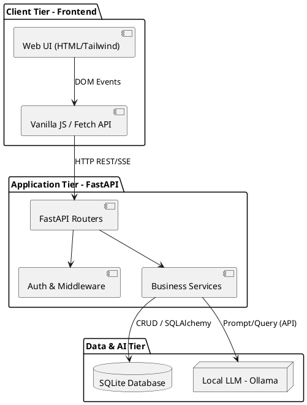
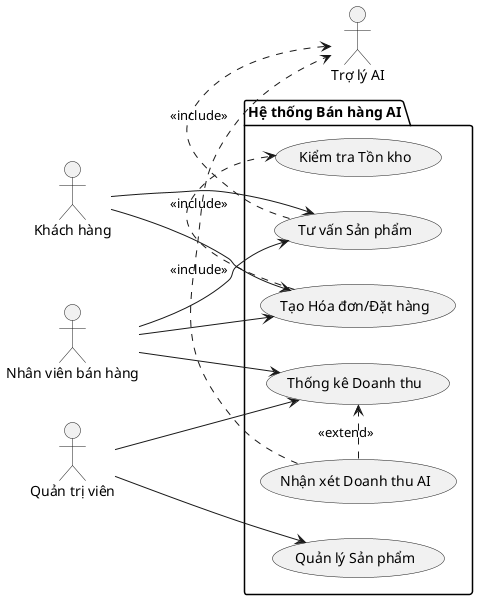
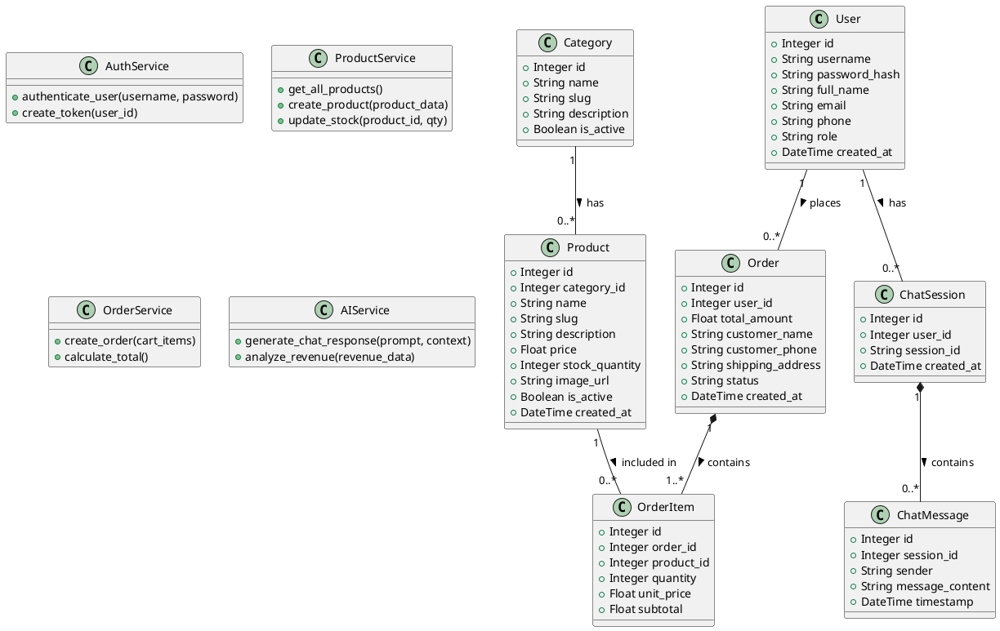
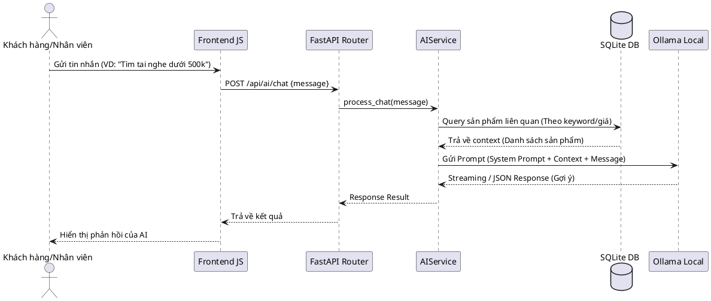
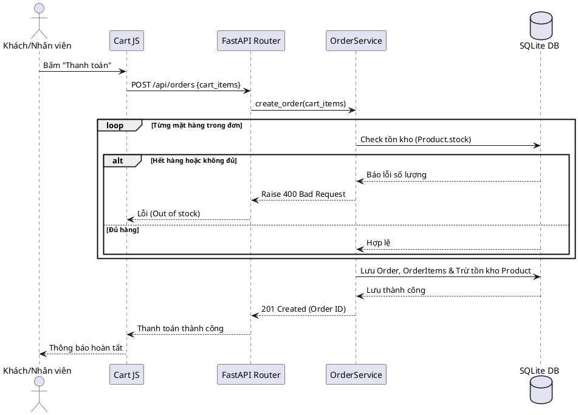
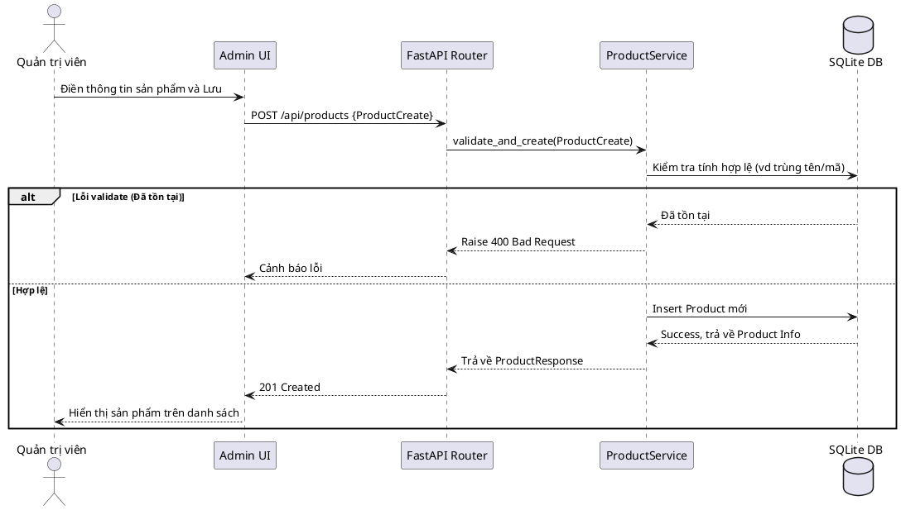

# Thiết kế Hệ thống và Thiết kế Hướng đối tượng (System & OOD)

Tài liệu này đặc tả kiến trúc phần mềm, mô hình dữ liệu, sơ đồ tuần tự và danh sách các API cho dự án **Hệ thống Quản lý Bán hàng Tích hợp AI**. Tài liệu bám sát yêu cầu nghiệp vụ từ SRS/Phân tích yêu cầu và tuân thủ các quy chuẩn trong `ANTIGRAVITY.md`.

---

## 1. Kiến trúc tổng thể hệ thống (Architecture Overview)

Hệ thống được thiết kế theo mô hình **3 Tầng (3-Tier Architecture)** phân tách rõ ràng trách nhiệm của giao diện, xử lý logic và lưu trữ dữ liệu/mô hình AI:

- **Client Tier (Presentation Layer):** Được xây dựng bằng HTML5, Tailwind CSS và Vanilla JS, đảm nhiệm hiển thị giao diện và tương tác người dùng, gọi API thông qua Fetch/AJAX.
- **Application/API Tier (Business Logic Layer):** Xây dựng trên nền tảng **FastAPI** (Python), cung cấp các API RESTful bất đồng bộ (async). Bao gồm Routers, Middleware (Xác thực, phân quyền) và Business Services.
- **Data & AI Tier:** Sử dụng **SQLite** cho việc lưu trữ dữ liệu quan hệ (Người dùng, Sản phẩm, Hóa đơn). Tích hợp module AI gọi đến local LLM (**Ollama**) xử lý các tác vụ RAG và sinh văn bản tự nhiên.

### Sơ đồ Khối Kiến trúc (COMP-001)

---

## 2. Mô hình hóa Use Case (Use Case Diagrams)

Phân rã chức năng theo các Actor chính tương tác với hệ thống.

### Chi tiết các Use Case chính

1. **UC1 - Tạo Hóa đơn/Đặt hàng:** Khách hàng (hoặc nhân viên bán hàng làm thay khách) thao tác chọn sản phẩm vào giỏ hàng, tính tổng tiền, áp dụng các mã giảm giá và hoàn tất thanh toán. Quá trình này bắt buộc phải gọi hệ thống con để kiểm tra số lượng tồn kho (`<<include>> UC6`).
2. **UC2 - Tư vấn Sản phẩm:** Người dùng (Khách hàng, Nhân viên) sử dụng chatbot để tra cứu thông tin hàng hóa, hỏi đáp cấu hình. Use Case này gọi hệ thống AI (`<<include>> Trợ lý AI`) để tiếp nhận tin nhắn, truy xuất CSDL và sinh ra câu trả lời bằng ngôn ngữ tự nhiên.
3. **UC3 - Quản lý Sản phẩm:** Cho phép Quản trị viên (Admin) thực hiện thao tác CRUD (thêm, sửa, xóa, cập nhật tồn kho, thay đổi trạng thái) đối với danh sách sản phẩm.
4. **UC4 - Thống kê Doanh thu:** Admin hoặc Chủ cửa hàng/Nhân viên (có quyền) xem được báo cáo số liệu, biểu đồ doanh thu theo khoảng thời gian và danh sách các sản phẩm bán chạy nhất.
5. **UC5 - Nhận xét Doanh thu AI:** Là chức năng mở rộng (`<<extend>>`) từ UC4. Khi đang xem báo cáo, người dùng có thể kích hoạt tính năng nhờ AI tóm tắt, phân tích và đưa ra đánh giá, nhận xét tình hình kinh doanh dựa vào số liệu hiện có.
6. **UC6 - Kiểm tra Tồn kho:** Use Case hệ thống, chạy ngầm, đối chiếu số lượng đặt hàng với số lượng thực tế trong CSDL để quyết định cho phép thanh toán hay không.

---

## 3. Thiết kế Sơ đồ Lớp (Class Diagram)

Thiết kế này (`CLS-001`) phản ánh cấu trúc Models (SQLAlchemy entities), Schemas (Pydantic DTOs) và Services xử lý logic.

---

## 4. Thiết kế Sơ đồ Tuần tự (Sequence Diagrams)

### 4.1. Luồng Tư vấn AI & Gợi ý sản phẩm (SEQ-001)

Mô tả kịch bản khi người dùng đặt câu hỏi tìm kiếm sản phẩm với AI.

### 4.2. Luồng Thêm vào giỏ hàng & Đặt hàng (SEQ-002)

Mô tả kịch bản lập hóa đơn/thanh toán có tính toán tồn kho.

### 4.3. Luồng Quản trị thêm mới sản phẩm (SEQ-003)

---

## 5. Đặc tả Giao diện API (RESTful API Specifications)

Dưới đây là danh sách đặc tả các REST API (`API-001` đến `API-009`) giao tiếp giữa Client và Server.

| ID          | Method | Endpoint                    | Mô tả chức năng                         | Request Body / Params              | Response Code | Yêu cầu (Trace) |
| ----------- | ------ | --------------------------- | ------------------------------------------- | ---------------------------------- | ------------- | ----------------- |
| `API-001` | POST   | `/api/auth/login`         | Xác thực đăng nhập, cấp JWT Token     | `{username, password}`           | 200, 401      | REQ-F-004         |
| `API-002` | GET    | `/api/products`           | Lấy danh sách sản phẩm, tồn kho        | `?category=`, `?search=`       | 200           | REQ-F-001         |
| `API-003` | GET    | `/api/products/{id}`      | Lấy chi tiết thông tin 1 sản phẩm      | `{id}` (Path)                    | 200, 404      | REQ-F-001         |
| `API-004` | POST   | `/api/products`           | Thêm mới một sản phẩm (Require: Admin Role)| `{name, price, stock, category}` | 201, 400      | REQ-F-001         |
| `API-005` | PUT    | `/api/products/{id}`      | Cập nhật sản phẩm (Require: Admin Role) | `{price, stock, status}`         | 200, 404      | REQ-F-001         |
| `API-006` | POST   | `/api/orders`             | Tạo hóa đơn bán hàng (Thanh toán)    | `[{product_id, qty}]`            | 201, 400      | REQ-F-002         |
| `API-007` | GET    | `/api/reports/revenue`    | Thống kê doanh thu, bán chạy            | `?start_date=`, `?end_date=`   | 200           | REQ-F-003         |
| `API-008` | POST   | `/api/ai/chat`            | Trợ lý Chatbot tư vấn sản phẩm        | `{message, session_id}`          | 200, 500      | REQ-AI-002        |
| `API-009` | POST   | `/api/ai/analyze-revenue` | AI đọc và nhận xét dữ liệu doanh thu | `{revenue_data}`                 | 200, 500      | REQ-AI-001        |
| `API-010` | PUT    | `/api/config`             | Cập nhật cấu hình hệ thống (Require: Admin Role) | `{settings}`                  | 200, 403      | REQ-F-006         |
